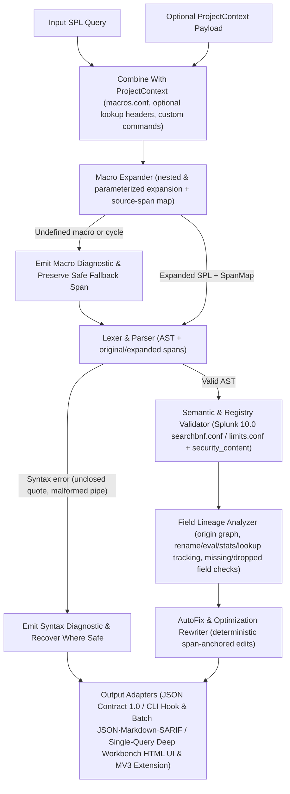

# Architecture Overview

## 1. Positioning, Core Promises & Out-of-Scope Boundaries

`spl_validator` is an offline static analysis tool for **Splunk Enterprise 10.0** SPL queries. It serves detection engineers maintaining SPL rules in Git repositories, security analysts verifying and refining searches in a browser or terminal, and automated review workflows checking generated SPL.

The system guarantees fully local, zero-network execution that checks syntax, command and function semantics, Splunk default limits, expanded macro queries, field origins and dependencies, and safe rewrite suggestions.

### Current Baseline vs. Approved Target (`ADR-001`)

| Dimension | Current Baseline (as of 2026-11-24) | Approved Target ([`ADR-001`](docs/decisions/ADR-001-typescript-single-core-and-consolidation.md)) |
|---|---|---|
| Core engine | Dual codebase: Python core (`spl_validator/`) plus experimental TypeScript port (`typescript/core/`) | **Single pure-TypeScript core** (`@spl-validator/core`) with zero Node/DOM dependencies; Python core stays frozen as a read-only regression reference through Phase 0–2 and is archived/removed after Phase 3 parity acceptance |
| Registry authority | Python `commands.py` / `functions.py` exported to `typescript/core/src/generated/registryData.ts` | Native TypeScript registry reconciled from obtainable Splunk 10.0 `searchbnf.conf` and `limits.conf` plus `splunk/security_content` |
| Macros | Treated as opaque backtick tokens (not expanded) | Real expansion of nested and parameterized macros from caller-supplied `macros.conf` with original source-span mapping |
| Field analysis & rewrites | Basic field tracking and advisory suggestions | Pipeline field-lineage graph (tracing which upstream values feed every output field), missing/dropped field diagnostics, and deterministic AutoFix/optimization rewrites |
| Delivery surfaces | Python CLI/HTTPD/Web UI/Textual TUI, legacy HTTP extension (`browser_extension/`), TS CLI (`@spl-validator/runtime`), standalone MV3 extension (`@spl-validator/extension`) | Three thin surfaces on `@spl-validator/core`: (1) **Node.js >= 22 LTS** CLI packaged as dual-mode single-file `spl-validator.cjs` (one-shot CLI, save-time & `macros.conf` reverse-impact hooks, `batch` -> JSON/Markdown/SARIF, and lazy stdio NDJSON worker + thin Python stdlib wrapper; standalone native binary e.g. Node SEA in `M-06`); (2) **Single-Query Deep Workbench** static HTML Web UI (diagnostics + AutoFix diff preview, side-by-side macro highlight, interactive field lineage graph, local `macros.conf`/CSV header upload); (3) standalone MV3 Chromium extension directly reusing the same workbench UI (Textual TUI and HTTP-backed legacy extension deprecated) |
| Reference assets | Split between `spl_validator` and `spl-expert` | Consolidated under `spl_validator` as the sole main repository |

**Out of scope**: `spl_validator` operates strictly offline. Connecting to a live Splunk server, executing searches against indexed events, validating runtime index permissions, or querying live lookup tables belongs outside this repository.

## 2. End-to-End Validation Pipeline & Failure Handling

The target analysis pipeline runs deterministically inside `@spl-validator/core`, with optional filesystem/context loading kept in outer adapters (`@spl-validator/runtime` or browser inputs):

### Runtime Control & Failure Paths

- **Missing optional context**: When no `ProjectContext` is provided (for example, quick paste in the browser UI), the pipeline skips external lookup/custom-command checks and reports unexpanded macros explicitly instead of failing fatally.
- **Macro expansion failures**: Undefined macros, argument-count mismatches, or recursive expansion cycles produce explicit diagnostics anchored to the call site and stop expansion of that macro safely without infinite loops.
- **Source-span remapping**: Diagnostics and AutoFix edits produced on expanded SPL remap positions back to the user's original query line/column while retaining expanded context for inspection.
- **Dual-mode hook, `macros.conf` reverse-impact & CI exit behavior**: `@spl-validator/runtime` targets **Node.js >= 22 LTS** and ships during development as a single-file dual-mode `spl-validator.cjs` bundle—**one-shot CLI mode** for Git pre-commit/CI, low-frequency saves, `macros.conf` reverse-impact revalidation of dependent rules, and `batch` repository scans (`JSON` / `Markdown` / `SARIF`), plus **lazy stdio NDJSON worker mode** paired with a thin Python standard-library wrapper for long-lived Python services. Deterministic exit codes (`0` valid, `1` validation errors, `2` usage/context-load error) gate saves and commits cleanly without parsing unstructured text; standalone native binary packaging (e.g., Node SEA) is scheduled as a later distribution milestone (`M-06`).

## 3. Bounded Subsystems, Narrow Interfaces & Forbidden Couplings

| Subsystem | Location | Maturity Stage | Public Interface & Responsibility |
|---|---|---|---|
| Pure Core Engine (`@spl-validator/core`) | `typescript/core/` | `usable` | Pure functions `validate(spl, options, context?)`, planned `expandMacros`, `analyzeLineage`, `suggestFixes`, and `buildValidationJsonDict`. Zero Node or DOM imports. |
| Project Context Adapter | Planned in `typescript/runtime/` (and browser file loader) | `prototype` | Reads `macros.conf`, optional lookup CSV headers, schema JSON, and custom command packs into a plain serializable `ProjectContext` object passed to core. |
| CLI & Hook Runner (`@spl-validator/runtime`) | `typescript/runtime/` | `usable` | **Node.js >= 22 LTS** CLI (`spl-validator-ts` / planned single-file dual-mode `spl-validator.cjs`) supporting one-shot CLI, save-time hooks, `macros.conf` change reverse-impact checks, `batch` repo inspection (`JSON`/`Markdown`/`SARIF`), and lazy stdio NDJSON worker + thin Python stdlib wrapper (standalone native binary e.g. Node SEA in `M-06`). |
| Standalone Browser Surfaces | `typescript/extension/` and planned static HTML UI | `usable` (extension) / `prototype` (static HTML UI) | Zero-server **Single-Query Deep Workbench** (diagnostics + AutoFix diff preview, side-by-side macro expansion highlight, interactive field lineage graph, local `macros.conf`/CSV header upload) shared directly between the static HTML Web UI and standalone MV3 Chromium extension on `@spl-validator/core`; batch repo inspection stays on the CLI. |
| Frozen Python Baseline & Legacy Extension | `spl_validator/`, `browser_extension/` | `stable` (frozen) | Read-only regression reference (307 tests, JSON schema contract `1.0`, `security_content` scanner) kept across Phase 0–2 and archived/removed from the main tree only after Phase 3 parity acceptance passes. |

### Forbidden Couplings

| Forbidden Coupling | Why Banned | Enforced By |
|---|---|---|
| `@spl-validator/core` importing Node built-ins (`node:fs`, `node:path`, `process`) or DOM/browser APIs (`window`, `document`, `chrome`) | Keeps one core bundle runnable identically in Node CLI, MV3 extension, and static HTML Web UI | TypeScript build config, code review, and future `docs/specs/` boundary checks |
| CLI, extension, or Web UI implementing custom SPL parsing, regex macro expansion, or command allowlists outside `@spl-validator/core` | Prevents validation drift between hook CLI and browser surfaces | Single analysis entrypoint in `@spl-validator/core` |
| Expanding Python (`spl_validator/`) as the canonical registry for new features after `ADR-001` | Prevents permanent dual-maintenance drift during TypeScript consolidation | [`ADR-001`](docs/decisions/ADR-001-typescript-single-core-and-consolidation.md) & [`AGENTS.md`](AGENTS.md) |
| Hardcoding external rule-repository schemas (such as proprietary YAML or Python managers) inside `@spl-validator/core` | Keeps core generic and reusable; external repos connect through thin CLI hooks and `ProjectContext` | Narrow `ProjectContext` boundary |

## 4. Single Source of State & Migration Invariants

### Authoritative Owners

| Fact or Artifact | Single Authoritative Owner | Guard / Synchronization Rule |
|---|---|---|
| Verbatim owner direction quotes | [`docs/sources.toml`](docs/sources.toml) (`SRC-*`) | Append-only chronological ledger in original language; linked by ADRs and tasks |
| Cross-module architecture decisions | [`docs/decisions/ADR-*.md`](docs/decisions/ADR-001-typescript-single-core-and-consolidation.md) | Supersede explicitly rather than silently rewriting prior rationale |
| Roadmap milestones & task states | [`docs/work.toml`](docs/work.toml) | Only file tracking task status and `human_check` confirmation |
| Discipline policy, adoption stage & budgets | [`docs-policy.toml`](docs-policy.toml) | Single owner of `discipline_version`, `[adoption].stage`, and line budgets |
| Machine-readable output contract | [`docs/contract/cli-json-output.schema.json`](docs/contract/cli-json-output.schema.json) | `output_schema_version = "1.0"`; additive fields must stay backward compatible |
| Cross-language parity fixtures | `tests/golden/*.json` | Executed by both Python and TypeScript test suites during transition |
| Built-in SPL command/function/limit registry | Transitional: exported from `spl_validator/src/registry/` into `typescript/core/src/generated/registryData.{json,ts}`; Target (`M-02`): native TypeScript data reconciled from obtainable Splunk 10.0 `searchbnf.conf` & `limits.conf` | Never hand-edit generated files; switch canonical ownership cleanly in `M-02` once parity passes |

### Hard Migration & Runtime Invariants

1. **`security_content` strict-mode floor**: Maintain at least the **98.85%** strict-mode valid rate (1,983 / 2,006 detections from the 2026-03-20 snapshot in [`docs/security_content_validation.md`](docs/security_content_validation.md)) unless any newly flagged detection is confirmed to be an actual SPL defect.
2. **307-test & Phase 3 parity acceptance floor**: Keep `spl_validator/` frozen as a read-only regression reference across Phase 0–2, and archive/remove it from the main tree only after Phase 3 parity acceptance passes across the 307-test Python suite (`tests/`), shared golden fixtures, the >= 98.85% `security_content` strict corpus, and the new macro-expansion and field-lineage test suites.
3. **Offline & zero-telemetry guarantee**: No outbound network requests, analytics, or elevated browser permissions (`typescript/extension/src/manifest.json` requests zero browser permissions).
4. **Contract stability**: Required top-level and issue fields in [`docs/contract/cli-json-output.schema.json`](docs/contract/cli-json-output.schema.json) (`valid`, `errors`, `warnings`, and issue `code`, `message`, `line`, `column`, `suggestion`) remain stable when adding macro-expansion, field-lineage, or AutoFix output sections.

## 5. Entrypoints & Fitness Checks

- **Working agreement & build commands**: [`AGENTS.md`](AGENTS.md)
- **Strategic decisions & rationale**: [`docs/decisions/ADR-001-typescript-single-core-and-consolidation.md`](docs/decisions/ADR-001-typescript-single-core-and-consolidation.md)
- **Active milestones & tasks**: [`docs/work.toml`](docs/work.toml)
- **Discipline adoption inventory**: [`docs/discipline-adoption.md`](docs/discipline-adoption.md)
- **Primary verification**:
  - TypeScript build and tests (requires **Node.js >= 22 LTS**): `cd typescript && npm run build && npm test`
  - Python regression baseline (read-only reference through Phase 0–2): `pytest tests/`
  - External corpus benchmark: `python3 tools/scan_external_detections.py --root /path/to/security_content/detections`
